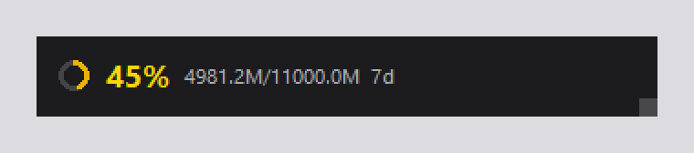

# mimo-usage-monitor

MiMo Token Plan 用量桌面监控小工具：**悬浮工具条 + 系统托盘**常驻显示套餐 Credits 用量，自动登录、定时刷新、阈值提醒、开机自启。



## 功能特性

- **悬浮工具条**：置顶无边框暗色玻璃卡片，可拖动 / 锁定 / 调透明度，右下角手柄调大小，双击打开控制台；内容随宽度渐进显示——宽条（百分比 + 进度环 + 额度 + 剩余天），窄条（百分比 + 进度环）
- **托盘图标**：动态百分比环（绿 → 黄 → 红），tooltip 显示明细，额度越过阈值弹气泡提醒
- **自动登录**：多级降级全自动——Edge/Chrome 会话导入 → WebView 落盘会话 → 小米 SSO 无感换会话 → 内置登录窗 → 粘贴 Cookie 应急；会话过期自动重登
- **健壮性**：单实例互斥；刷新失败指数退避（60s → 120s → … 封顶 300s）；断网保留上次数据并标记「⚠ 已过期」
- **个性化**：字体 / 字号、刷新间隔（30–600 秒）、提醒阈值、透明度、开机自启，均可在设置里调

## 快速开始

```bash
pip install -e .[dev]
pytest
python -m mimo_usage_monitor
```

## 启动脚本（Windows）

双击 `start.bat` 打开管理菜单，服务在**后台隐藏运行**（无窗口），日志写入 `logs\mimo-monitor.log`：

- `1` 启动服务 / `2` 重启服务 / `3` 停止服务
- `4` 查看状态（PID + 最近日志）
- `5` 查看日志（最近 60 行）/ `6` 实时跟踪日志（Ctrl+C 退出）
- `7` 清空日志（需先停止服务）/ `0` 退出菜单（服务继续后台运行）

也支持命令行用法（便于计划任务 / 快捷方式）：

```bat
start.bat start|restart|stop|status|log|tail|clear
```

## 显示形态

两形态可同开，独立开关（托盘右键菜单）。

**窄条形态**（百分比 + 进度环，适合小屏 / 贴边）：


**托盘百分比环**（绿 → 黄 → 红三态）：


## 登录与凭证

按优先级自动选择：

1. **从 Edge/Chrome 导入**：读取浏览器已登录的 `xiaomimimo.com` 会话（依次尝试 Edge、Chrome；浏览器运行中锁库或 Cookie 为 v20 加密时不可用）
2. **WebView/SSO 通道**：读取内置 WebView 自己的落盘会话 → 拿小米 SSO 登录态（passToken）无感换出平台会话 → 都不行才弹登录窗（登录一次即可，之后自动续）
3. **粘贴 Cookie 应急通道**：WebView 不可用时，浏览器登录后手动粘贴 cookie

**隐私说明**：凭证只保存在本机（DPAPI 加密于 `%APPDATA%\mimo-usage-monitor\session.bin`）；程序仅访问 `platform.xiaomimimo.com` 接口与小米账号 SSO 登录页，不采集、不上传任何其他数据；日志只记录登录通道的成败，不含凭证内容。

## 故障排查

- 登录窗空白/打不开：安装 [WebView2 运行时](https://developer.microsoft.com/microsoft-edge/webview2/)（Win11 自带）
- 浏览器导入不生效：新版 Edge/Chrome 运行中会独占 Cookie 库，且 v20 App-Bound 加密不可解（浏览器有意防窃取）——属预期，改用 WebView 登录一次即可，之后自动续
- 登录问题看日志：`logs\mimo-monitor.log` 会逐通道打印 `[登录] xxx: 成功/未取到`
- 用量显示「⚠ 已过期」：网络故障保留的是上次数据，恢复后自动续上
- 悬浮条不见了：多半是位置保存在了已断开的显示器/旧分辨率之外，重启即自动拉回屏幕右上角（托盘菜单「悬浮条」可开关）
- 诊断导入问题：`python tools/diag_browser_cookies.py`（只显示 cookie 名与加密前缀，不显示值）

## 开发

```bash
pytest                                  # 测试（78 项）
python tools/make_screenshots.py        # 重新生成 README 截图（只截工具本身）
python tools/diag_browser_cookies.py    # 浏览器 cookie 导入诊断
python tools/probe_api.py               # 探查 tokenPlan 接口响应结构
```

## 文档

- 设计文档：`docs/superpowers/specs/2026-11-01-mimo-usage-monitor-design.md`
- 实现计划：`docs/superpowers/plans/2026-11-01-mimo-usage-monitor.md`
- 接口字段表：`docs/api-shape.md`

## License

[MIT](LICENSE)
